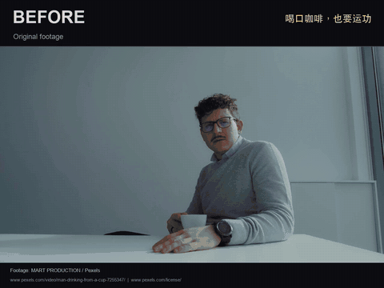
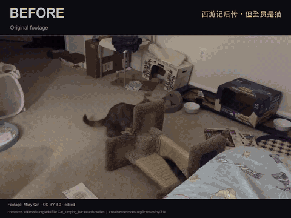

<div align="center">

# 一个动作，值得放三遍。

### 西游记后传式剪辑 Skill

**喝口咖啡，也要运功。猫咪一跳，三界震动。**

把你的日常视频，剪成一场迟迟打不完的神魔大战。

[先看效果](#先看效果) · [安装](#安装) · [让你的视频成仙](#让你的视频成仙) · [原剧节奏拆解](references/original-rhythm.md)

</div>

## 先看效果

### ☕ 别人喝咖啡，你在吸收天地灵气。



举杯 → 运功 → 再运一次 → 特写收功。一个日常动作，拥有决战的排面。

[▶ 看带功夫音效的 MP4](https://raw.githubusercontent.com/alex-ybuild/xiyou-houchuan-edit/main/assets/demos/coffee.mp4)

### 🐈 猫咪只是跳了一下，导演觉得事情没那么简单。



全景交代动作，中景再来一遍，镜像换边，特写加一道法术。

[▶ 看带功夫音效的 MP4](https://raw.githubusercontent.com/alex-ybuild/xiyou-houchuan-edit/main/assets/demos/cats.mp4)

*动图静音；MP4 带功夫音效。素材：MART PRODUCTION / Pexels；Mary Qin / CC BY 3.0。剪辑、镜像和法术均为本项目改编，详见[演示来源与许可](assets/demos/CREDITS.md)。*

## 后传味，从哪里来？

**动作已经结束，气势还没到位。再来一遍。**

| 招式 | 画面里发生什么 |
| --- | --- |
| 动作三连 | 同一个动作，原方向 → 镜像 → 原方向，峰值反复强调 |
| 放大切分镜 | 全景、中景、手部或表情特写，把一个机位拆出层次 |
| 关键帧推近 | 起势蓄力、出招急推，接触时短促震动，锚点跟着主体走 |
| 每遍都有声 | 挥动有「咻」，峰值有击打，BGM 连续铺底 |
| 强法术档 | 金紫描边、光束闪电、分身残影、落地光圈与烟尘 |

我们找了原剧打斗，逐镜拆了重复区间、景别和音效位置，记录了 **13 / 13 / 13 帧**的三连样例，以及另一段全景／近景切换。剪辑先对齐动作，再决定特效。[看原剧实测 →](references/original-rhythm.md)

## 安装

给 Codex 装上这门功法：

```bash
git clone https://github.com/alex-ybuild/xiyou-houchuan-edit.git ~/.codex/skills/xiyou-houchuan-edit
```

如有自定义 `CODEX_HOME`，改装到其 `skills/` 目录。目标文件夹已存在时先备份自己的版本。若技能未出现，重新打开 Codex 会话。

## 让你的视频成仙

把视频交给 Codex，再说：

```text
用 $xiyou-houchuan-edit 剪这个视频，开启强法术档。
要明显的放大分镜、镜像三连和关键帧，动作峰值配功夫音效。
做约 15 秒，再导出一个 Before / After 对比版。
素材：/你的路径/input.mp4
```

也可以先收一点力：

| 档位 | 想要的感觉 |
| --- | --- |
| 标准剪辑 | 靠重复、景别、镜像和声音，让小动作拥有大场面 |
| 轻特效 | 增加局部光晕、短残影与克制的调色 |
| 强法术 | 描边、闪电、分身、光圈，日常动作也能施法 |

**宠物、真人日常、运动、产品都能按动作适配。** 每次重新分析事件和主体轨迹；普通举杯与猫咪腾空会有各自的镜头和特效设计。

### 灵魂 BGM 呢？

当然可以指定刘欢 **《我欲成仙》**：

```text
BGM 用刘欢《我欲成仙》，连续铺底，音效配合动作峰值。
音源用我提供的文件；如果取不到指定音源，请说明。
```

仓库演示使用 CC0 功夫音效，未附原曲。使用歌曲发布视频时，需确认相应的音乐使用权。

<details>
<summary><strong>运行环境、技能文件与验证</strong></summary>

这是 Codex 使用的技能与辅助代码。代理需要查看素材、设计时间线并调用可用渲染工具；特效函数由调用方提供当前素材的主体遮罩和轨迹。

完整剪辑需要 `ffmpeg` / `ffprobe`，或指定的可用视频编辑器。逐帧特效辅助代码依赖 Python、NumPy、Pillow：

```bash
cd ~/.codex/skills/xiyou-houchuan-edit
python3 -m venv .venv
.venv/bin/python -m pip install -r requirements.txt
```

| 文件 | 用途 |
| --- | --- |
| [SKILL.md](SKILL.md) | 动作分析、分镜、节奏、声音与交付规则 |
| [original-rhythm.md](references/original-rhythm.md) | 原剧打斗的逐镜实测与改编依据 |
| [effects.md](references/effects.md) | 轻／强特效、素材适配和遮罩要求 |
| [rendering.md](references/rendering.md) | 时间线、FFmpeg、音画同步与导出检查 |
| [action_fx.py](scripts/action_fx.py) | 遮罩驱动的描边、残影、光束与光圈函数 |

更新：`git pull --ff-only`，先处理自己的本地修改。

验证辅助代码：

```bash
.venv/bin/python -m unittest discover -s tests -v
```

测试覆盖空遮罩保持原画、特效局部性、尺寸错误和闪电可重复性。成片仍需检查动作节奏和声音。单机位裁切与镜像不能还原真实的三维视角；低清、静态素材会减少不适合的处理。

</details>

## 开源与素材

技能文档与原创辅助代码使用 [MIT License](LICENSE)。演示素材保留各自许可：[完整署名与改编说明](assets/demos/CREDITS.md)。第三方素材、歌曲和剧集不属于 MIT 许可范围。

---

<div align="center">

**你负责一个普通动作。它负责郑重其事地再放两遍。**

</div>
